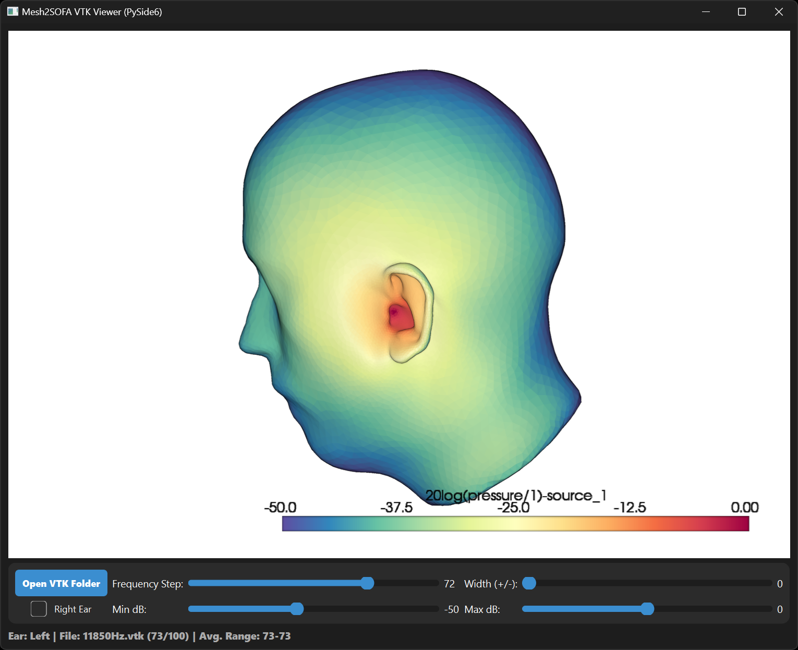
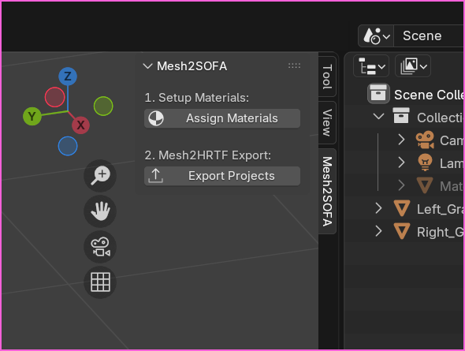

# Changelog

## Unreleased

- Separate pieces are now detected, and a very long ring is flagged (stage 5d): `inspect_mesh` counted 0 components on a mesh in several pieces (this PyMeshLab names the key differently) and reported it fine; the count now also comes from the faces (scipy), so such a mesh is critical ("N separate pieces") on import and in Step 2, and a failed measure is reported instead of silently counting 0. Tunnel fixer: a ring longer than 25 % of the mesh's bounding-box diagonal shows "This ring is unusually long - check it before applying" on its card and that defect is left out of "Apply recommended fix". Repair never silently deletes a substantial piece: if two or more pieces each hold more than 1 % of the faces, repair refuses, leaves the file untouched, and Step 2 ends at the "stuck" dialog saying to remove the unwanted piece in Blender and import again; smaller debris (1 % or less) is still dropped and the log says how many pieces.

- Restore button only while it can do something (stage 5c): "Restore mesh from before Step 2 fixes" now moves the validated backup over `aligned_head.ply` (atomic), so the button hides after use and returns when the next repair or tunnel fix makes a new backup. A rejected backup leaves both files untouched.

- Tunnel fixer, clearer one-click button: it now reads "Apply all recommended fixes [R]" when the panel shows several defects (and "Apply recommended fix [R]" for one), so the important part is on the button and not only in the small caption; when the button is disabled, the reason is shown in the same warning colour as the "look closely" note.

- One-click Step 2: "2. Inspect & Fix Mesh" now inspects, repairs automatically once (through the same single backup as the tunnel fixer), and opens the tunnel fixer by itself when only see-through holes are left, with no dialog in between. If the automatic repair can't fix the mesh, one plain-language dialog offers "Try repair again" / "Close" and the tunnel fixer is not offered (it needs a watertight mesh). Closing the fixer without keeping a fix just logs "mesh unchanged"; after a kept fix with holes remaining you can choose "Fix the next defect". `repair_aligned` exits 0 when only tunnels remain, no longer rewrites a mesh that has nothing to repair, and the restore button is now "Restore mesh from before Step 2 fixes". Decision logic lives in the new `core/inspect_flow.py`. The recommended-fix button explains a defect that has only one safe option and no longer claims it fills the hole for defects you chose yourself.

- Tunnel fixer, one-click default: new "Apply recommended fix" button (key R) fills the hole for every defect, then shows the usual before / after with Keep and Undo (nothing is saved before Keep). Defects where it couldn't tell hole from bridge need your own pick first, and an unavailable "Fill the hole" option disables the button instead of falling back to the other one. Technical labels, loop lengths, linking numbers and "Export Loops for Blender" moved into a collapsible Advanced section (opens by itself when cutting is disabled); history events now record `"via": "recommended"`.

- Tunnel fixer, record every choice: each Keep and each Undo of a tunnel fix is appended to `cutpatch_history.json` next to `aligned_head.ply` (time, mesh, genus and face counts, and per defect which option was chosen, loop lengths, linking numbers and whether it was the pre-selected one). It survives re-align and re-import, and a failure to write it never blocks saving.

- Tunnel fixer safety pass: C / Apply in the tunnel viewer now asks for confirmation first, keeps a one-time backup (`aligned_head.pre_cutpatch.ply`, made before the first fix since the last alignment) and saves atomically, so a failed cut can never damage `aligned_head.ply`. New "Restore mesh from before hole fix" button in the main window; re-aligning removes the backup.
- Cut & patch is stricter: exactly 2 holes per loop, union checks for multi-loop cuts, post-patch checks (watertight, 1 component, genus, face count), and the second loop of a pair is verified when the viewer opens (an unusable one is greyed out instead of failing after you press C).
- Viewer: panel buttons no longer take keyboard focus (Space/Tab/C always work), "Save & Close" renamed "Close without fixing", Export shows the path it wrote, Apply is blocked while a cut is running.
- Tunnel fixer clear-UI pass: plain wording everywhere ("Fill the hole" / "Remove the bridge", "Defect 1 of 2"; technical names only in tooltips), one question plus two clickable option cards with Prev / Next and a single Apply, camera zooms to the defect (Z / H / X and buttons for zoom, whole head, see-through), plain progress messages, the cut runs off the GUI thread (window stays responsive; closing is blocked while it runs), and honest notes for "showing k of g defects", ambiguous options and unavailable options. "Restore mesh from before hole fix" now refuses an empty or unreadable backup and leaves the current mesh untouched.
- Tunnel fixer, see the result: Apply (`C`) no longer asks first and no longer saves straight away. It shows the fixed mesh in the main view (camera stays on the patch, banner "Fixed — N defects left") with **Keep & Close** (backup + save + close) and **Undo** (`Esc`; nothing is written). Closing with an unkept fix asks "Discard this fix?". Each option's real result is now previewed in the background: cards show "Preparing preview…" / "Preview ready" / "Not available — <reason>" (unavailable options are greyed out), and **P** (or the Show: Before / After button) switches the view between the mesh and the selected option's preview. With one defect, Apply saves exactly the previewed mesh. The window now appears immediately (the mesh checks run in the background), and the restore-backup check also rejects a truncated ASCII PLY.
- Tunnel fixer, visibility pass: the zoom-to-defect camera now looks at the defect from a direction where it is actually visible (candidate views around the outward direction and each ring's normal are ray-tested against the mesh, least hidden wins; the view is cached per defect) and switches see-through on by itself, with a note, when even the best view is mostly hidden. The After view / preview colours the faces the fix added in soft green ("Green = new surface added by the fix"). The long red/blue lines across the zoomed view were the label leader lines; labels now sit near their ring and the leaders are thin grey.

## v1.7.1 (2026-11-17) — Parallel NumCalc Stability Test with Live Progress

The Step 6 stability test now runs both ears at once instead of one after the other
(roughly halving the wait) and reports real progress instead of a silent console.

**1. NumCalc stability test (`core/run_numcalc_test.py`)**
- Left and Right NumCalc runs start together from one worker; the GUI launches it with a
  single command.
- Live `[L]`/`[R]` progress: phase transitions (assembling, solving, post-processing,
  done) parsed from NumCalc's `NC<i>-<i>.out` log, solver iterations and error, plus a 30 s
  heartbeat with elapsed time, NumCalc memory use and free RAM.
- RAM watchdog: if free memory drops below 4 GB, the last-started ear is stopped and re-run
  after the other finishes. `--sequential` forces one-at-a-time.
- Fixed: the test always reported success; it now fails if either ear's NumCalc fails.
- Logs left over from earlier runs are ignored, and the console stays responsive with
  unusual characters in NumCalc output or non-English folder names.
- New `tests/test_numcalc_test.py` (27 tests, using a fake NumCalc).

## v1.7.0 (2026-11-16) — Skin/Hair Absorption, HiRes Mode & NumCalc Completion Fix

Adds frequency-dependent skin and hair absorption boundary conditions (Brinkmann et
al. 2025) to the Blender add-on, a third "HiRes" project resolution (20 kHz, 100 Hz
steps), and fixes Step 7 staying locked after a full NumCalc run.

**1. Boundary conditions (Blender add-on v1.2.0)**
- New panel setting: **Skin absorption (Brinkmann 2025)** (default) or **Rigid (legacy)**,
  stored as Scene properties in the `.blend`.
- Skin mode writes `Exports/Materials/Skin.csv` (normalised admittance, 0–22050 Hz, 50 Hz
  steps) and passes it to Mesh2HRTF as `materialSearchPaths`; Rigid aborts if Mesh2HRTF's
  own material Data folder would silently make the export non-rigid.
- Optional **hair absorption** with adjustable slope *m*: `Auto-select Hair Region`
  (ear-exclusion cylinder around the interaural axis), `Assign Hair to Selected`, `Clear Hair`.
  Assign Materials now creates a 4th `Hair` slot.
- Every export's `NC.inp` is verified against the selected boundary; a mismatch is an error.
- The GUI logs the boundary found in the export when starting NumCalc (`describe_export_boundary`).
- New `tests/test_boundary_materials.py` covers the bpy-free physics with stub `bpy`/`bmesh`.

**2. HiRes resolution mode (`project_resolution: "hires"`)**
- 0–20000 Hz in 100 Hz steps (200 frequencies), same mesh grading as Standard; the 18–20 kHz
  band is experimental. SOFA generation passes `--double-length` so HiRes outputs are
  512 samples (Standard/Lowres unchanged at 256).
- Mode table (`RESOLUTION_MODES` / `resolution_mode()`) now lives in `core/project_store.py`;
  the add-on mirrors `(max_hz, step_hz)` and `tests/test_resolution_modes.py` asserts they match.
- `run_numcalc_test.py` takes its test index from the export's `parameters.json` instead of a
  hard-coded 107/120.
- New pre-NumCalc guard compares both ears' `parameters.json` with the project mode and
  warns-but-allows on a mismatch (e.g. mode changed after export, or a stale add-on).
- Changing mode on an exported project requires deleting `Exports/Left_Project` and
  `Right_Project` before re-exporting (Mesh2HRTF refuses to overwrite).
- Note: older Mesh2SOFA versions opening a `hires` project display it as Standard, and
  clicking the mode toggle there would overwrite the value.

**3. NumCalc completion fix**
- Workers are launched with `stdin=DEVNULL` and the full run passes `--confirm_errors False`,
  so `manage_numcalc`'s "Hit Enter to exit" prompt no longer hangs the run and Step 7
  unlocks without restarting the app.

## v1.6.0 (2026-07-05) — Repo Reorg, Smarter DFHRTF Weighting & Cut-and-Patch

Splits the flat repo into `core/` (worker/library modules) and `tests/`, upgrades
the diffuse-field weighting to auto-detect spherical designs and handle
hemispherical grids correctly, trims a mastering-tool option, and lands the
tunnel "cut & patch" rename plus cap-quality improvements.

**1. Repository layout (`core/`, `tests/`)**
- All worker/library modules moved from root into `core/` (`align_head.py`,
  `mesh_inspector.py`, `mesh_problem_viewer.py`, `process_and_grade.py`,
  `run_numcalc_test.py`, `generate_sofa_outputs.py`, `generate_extras.py`,
  `generate_vtk_outputs.py`, `project_store.py`, `tunnel_loop_extractor.py`,
  `tunnel_loop_locator.py`, plus the new `geometry_weights.py`) alongside
  `readme_dfhrtf_calculation.md`. Only the user-run `_*.py` entry points remain in root.
- Test suite moved to `tests/` with a `conftest.py` that puts `core/` on `sys.path`.
- Entry points (`_project_manager_gui.py`, `_sofa_mastering_tool.py`) add a
  `CORE_DIR` bridge and launch every worker from `core/`; worker↔worker flat
  imports are unchanged (each runs as `python core/<worker>.py`).
- `mesh_inspector.py` now climbs one level out of `core/` to reach
  `blender_scripts/bmesh_cleanup.py`; `plans/tunnel-loop/` harnesses updated for the new paths.

**2. Smarter DFHRTF weighting (`core/geometry_weights.py`, `generate_extras.py`)**
- New shared `geometry_weights.py` (ported verbatim from the sofa_buddy project)
  auto-detects genuine spherical t/n-designs via a spherical-design quadrature
  test and returns exact uniform `1/N` weights for them (no error from
  unnecessary weighting).
- Non-design grids use a **ghost-node ConvexHull** (dense Fibonacci-cap of dummy
  points below the lowest real node) so open/hemispherical grids (e.g. ARI) get
  true solid-angle coverage instead of a bare-hull "floor" artifact.
- `generate_extras.py` consumes it, preserves the `--front_bias` post-step, and
  adds a `--weighting-mode {auto,geometric,uniform}` flag (default `auto`).
- Verified end-to-end on real fixtures: N-Design_55 → uniform, ARI → geometric.
- `readme_dfhrtf_calculation.md` rewritten to document the new method.

**3. Mastering tool cleanup (`_sofa_mastering_tool.py`)**
- Removed the "512 sample (edge case use only)" checkbox and its
  `--double-length` wiring — not needed for simulated HRTFs.

**4. Tunnel cut & patch (`tunnel_loop_extractor.py`, `tunnel_loop_locator.py`, `mesh_problem_viewer.py`)**
- "cut & cap" renamed to "cut & patch" throughout (`cut_and_patch`,
  `cut_and_patch_loops`, `cutpatch_report.json`).
- Hole filling switched from `meshing_close_holes` to **pymeshfix** for cleaner
  caps; new cap-halo remesh + tuned Taubin smoothing.
- `select_cut_loop` restores the green/red dual-loop pair by retrying
  `dual_crossing_loop` on the loose progenitor when the tight-loop call returns `None`.

**5. Reference grids & test fixtures**
- Added `evaluation_grids/` (N-Design / T-Design node sets + generator/plot scripts)
  and two `tests/*.sofa` fixtures (ARI hemispherical, N-Design_55 uniform) for
  grid-weighting checks. `*.sofa` un-ignored in `.gitignore` so fixtures can ship.

## v1.5.2 (2026-06-21) — Keyboard Tunnel Viewer & Import Safety

Replaces click-based loop selection in the tunnel viewer with keyboard-only
navigation, adds post-cut-&-patch auto-revalidation, and guards re-import with an
artifact-cleanup confirmation dialog.

**1. Tunnel viewer keyboard navigation (`mesh_problem_viewer.py`)**
- Click-to-select removed; Space=toggle cut loop, Tab/Shift+Tab=cycle handles,
  C=apply Cut+Patch — eliminates the drag-vs-pick conflict.
- Qt `eventFilter` intercepts Tab/Space before VTK or focus-traversal consumes them.
- `on_success` callback: viewer auto-closes after a successful Cut+Patch.
- Active-handle visual: wider/brighter rings; inactive handles tinted and thinner.
- On-canvas keyboard hint updates every redraw.

**2. Post-cut-&-patch auto-revalidation (`_project_manager_gui.py`)**
- Viewer writes `cutpatch_report.json` sentinel on success; GUI detects it in
  `_after_tunnel_viewer`, runs `repair_aligned`, then shows a good/bad popup.
- `_after_cutpatch_revalidated` reads `aligned_check.json` and surfaces residual
  issues or "All Clear" without requiring the user to re-open Inspect & Fix.

**3. New-mesh import safety (`_project_manager_gui.py`, `project_store.py`)**
- Before importing a new mesh, a confirmation dialog lists existing pipeline
  artifacts (aligned mesh, check files, graded meshes, loop exports) and warns
  they will be deleted.
- `ProjectStore.list_mesh_artifacts()` / `reset_mesh_artifacts()` enumerate and
  delete derived files; basenames logged for traceability.

**4. Sliver-collapse simplification (`blender_scripts/bmesh_cleanup.py`, `mesh_inspector.py`)**
- `bmesh_cleanup.py` reduced from 5 passes to 2 (`remove_doubles` + `triangulate`);
  extra `dissolve_degenerate` passes were redundant.
- Constants extracted: `MERGE_DETECT_THRESH = 0.295 mm`, `MERGE_FIX_THRESH = 0.305 mm`.
- Log messages updated to say "merge-by-distance" throughout.

## v1.5.1 (2026-06-20)

- Updated readme (it was way out of date).
- Fixed minor bug in `tunnel_loop_extractor.py`

## v1.5.0 (2026-06-20) — Formal Mesh Import Pipeline & Tunnel-Loop Robustness

Introduces a formal front-door import step (Browse → inspect → Blender sliver
dissolve → pymeshfix repair → re-inspect) and fixes the dual cut-loop viewer
regression that this cleaning caused on degenerate tight-loop meshes.

**1. Formal mesh import (`mesh_inspector.py`, `_project_manager_gui.py`)**
- New `import_mesh(dest_path, blender_exe)` function and `import_mesh` CLI
  subcommand. Flow: inspect → Blender `dissolve_degenerate` (if `tiny_faces > 0`)
  → pymeshfix repair → re-inspect → write `import_report.json`.
- Blender is **hard-required** at Browse time (blocks with an error if not set) —
  sliver dissolution only works in Blender.
- Raw Mesh field made **read-only** (`state="disabled"`); `_set_entry_raw` helper
  briefly re-enables to write programmatically. Browse is the only entry point.
- `_check_import_result` post-import popup: success, tunnel-warning, or residual-
  critical variants. Tunnel warnings are warn-only (can only be fixed post-align).
- `_bbox_unit_scale(ms)` — distinguishes mm vs metres from bbox diagonal
  (cutoff 10 units); scales dissolve distance accordingly.
- `tiny_faces` metric added to `inspect_mesh`: counts faces with min edge < 0.31 mm
  (unit-scaled); gates the Blender dissolve step and surfaces as a minor issue.

**2. Blender dissolve worker (`blender_scripts/bmesh_cleanup.py` — new)**
- Headless Blender script: `dissolve_degenerate(dist) + triangulate` on a PLY.
  Args after `--`: `<in_ply> <out_ply> <dist>`. Called by `_run_blender_dissolve`
  in `mesh_inspector.py` via `subprocess.run(check=True)`.

**3. Dual cut-loop robustness fix (`tunnel_loop_locator.py`)**
- The import cleaning collapsed tight loop A to a degenerate 3–4 vertex ring on
  some meshes. `dual_crossing_loop(A)` requires enough fan faces to split; a
  4-vertex ring fails → `None` → only one loop shown in the viewer.
- `locate_cut_loops` gains `with_loose=False` keyword, retaining the loose
  tree-cotree progenitor (already computed, no extra cost). Default unchanged.
- `select_cut_loop` retries `dual_crossing_loop` on the loose progenitor when
  the tight-loop call returns `None` (guarded by `len(loose) > len(A)`).
  Restores the green/red dual pair without touching tightening or cut/patch logic.
- Verified on `june_20` mesh: both loops (2.95 mm + 3.50 mm) appear, both sever
  `genus 1→0`, distinct vertex sets. All 11 tests pass; `test_vectorized_topo`
  ALL MATCH.

**4. patch quality improvements (`tunnel_loop_extractor.py`)**
- `cut_and_patch` / `cut_and_patch_loops` switch from `meshing_close_holes` to
  **pymeshfix** for hole filling — cleaner caps on complex tunnel geometries.
- `_remesh_selected_caps`: new helper; retessellates freshly-capped faces + a
  dilated halo to a uniform ~1.5 mm edge length (isotropic explicit remeshing).
  Runs between the pymeshfix fill and the Taubin smooth step. Silently no-ops on
  any PyMeshLab failure (patch is topologically valid at that point regardless).
- Taubin smoothing params tuned: `smooth_iters=5, taubin_lambda=0.4, taubin_mu=0.2`
  (previously 3 / 0.5 / −0.53).

**5. Align UI improvements (`align_head.py`)**
- Phase 1/2 panel text rewritten: fuller instructions, explicit controls list
  (P / Backspace / drag / pan / zoom), "SELECTED POINTS:" header above the list.
- Nose landmark renamed "NOSE TIP (Apex Nasi)" (was "NOSE BRIDGE (Nasion)").
- Phase 2 title updated to "Pitch Refinement"; save button renamed "Save Aligned
  Mesh" (was "Save & Inspect").
- Font stack updated to `'Roboto', 'Segoe UI', sans-serif`.

## v1.4.1 (2026-06-19) — Pipeline Integration, Qt Viewer & ProjectStore

Completes the v1.4.0 mesh inspection & tunnel-loop work: the viewer is a proper
Qt+QThread app, tunnel cutting works in-app with one keypress, and the GUI now
tracks inspection state reliably across re-align and viewer-exit events.

**1. ProjectStore (`project_store.py` — new module)**
- Central owner of all project.json and check-file I/O (`aligned_check.json`,
  `mesh_check.json`). `CleanState` enum (CLEAN / CRITICAL / NOT_RUN) with
  consistent absent/corrupt → NOT_RUN semantics.
- `clear_check(mesh)` — new idempotent delete; called by `align_head.py` after
  every save so a re-aligned mesh always reverts to NOT_RUN (prior "ok" no
  longer survives an in-place overwrite of `aligned_head.ply`).
- All worker scripts (`process_and_grade.py`, `run_numcalc_test.py`,
  `mesh_inspector.py`) ported from hand-rolled JSON to ProjectStore.

**2. GUI: Inspect & Fix step (`_project_manager_gui.py`)**
- New **Step 2 "Inspect & Fix Mesh"** button; `AlignedMeshDialog` shows issues,
  offers pymeshfix repair or tunnel-viewer launch. Inspect is OPTIONAL — warns
  but does not block grading.
- `_watch_viewer(proc, on_close)` — polls the detached viewer process and calls
  `_check_aligned_quality_result` (or `_check_mesh_quality_result`) on close.
  Inspect button restyles to "done" automatically after a successful in-app cut
  & patch with no manual refresh needed.
- Align renamed to "1. Align Mesh"; step labels renumbered 1–7.

**3. Tunnel viewer rewrite (`mesh_problem_viewer.py`)**
- Qt+QThread window: appears immediately with base mesh + fast overlays; cut-loop
  computation runs in a background QThread with a progress bar overlay.
- `TunnelSelector.apply_cut_and_patch()` — one-click "Apply Cut+Patch  [C]":
  runs `cut_and_patch_loops`, saves over `aligned_head.ply`, refreshes
  `aligned_check.json`. Falls back to exported loops (manual Blender) on failure;
  original file is never left in a bad state.
- `compute_tunnel_data` / `render_tunnel_data` split the old monolithic
  `add_tunnel_overlay` so the background worker stays VTK-free.

**4. In-app Cut+Patch (`tunnel_loop_extractor.py`)**
- `cut_and_patch(pts, faces, loop_verts)` — deletes the 1-ring band, caps holes
  with PyMeshLab `meshing_close_holes`, verifies genus drops by exactly one,
  applies Taubin smoothing on the patchboundary.
- `cut_and_patch_loops(pts, faces, loops)` — batched variant for multi-handle
  meshes; all bands deleted before any re-indexing.
- `_topo_counts(faces)` — vectorized numpy/scipy topology, replacing NetworkX
  graph rebuilds (~3-4x faster; torture mesh 2: ~51 s -> ~16 s).
- `dual_crossing_loop` ported from NetworkX to scipy `dijkstra` (batch across
  all fan-side sources at once).

**5. Mesh inspector improvements (`mesh_inspector.py`)**
- pymeshfix is now the **primary repair engine**. Legacy PyMeshLab chain is the
  fallback if pymeshfix is unavailable.
- `inspect_aligned` / `repair_aligned` CLI subcommands write `aligned_check.json`.
- `boundary_edges` added to counts; non-manifold counts now come from
  `get_topological_measures()` (the old `select_non_manifold_*` filters do not
  exist in current PyMeshLab and produced bogus -1 counts).
- Genus suppressed on non-watertight meshes to avoid false alarms.

**6. Progress callbacks (`tunnel_loop_locator.py`)**
- `locate_cut_loops` and `select_cut_loop` accept an optional `progress_cb`
  forwarded through the QThread worker to the viewer's status bar.

**7. Dependencies**
- `pymeshfix` added to `requirements.txt` (primary repair engine).

## v1.4.0 (2026-06-17) — Mesh Inspection & Tunnel-Loop Detection

A new pre-simulation **mesh inspection stage** that detects topological tunnels
(genus > 0 scanning artifacts — the "pierced-ear" see-through holes) and helps
the user remove them before BEM. BEM/NumCalc needs a watertight, genus-0 surface.

**1. Mesh inspector (`mesh_inspector.py`)**
- Reports boundary/non-manifold edges, components, self-intersections, and
  **genus** for a mesh. Output is ASCII-only (`[X]`/`[!]`/`[OK]`) so it never
  crashes the Windows cp1252 console or corrupts the GUI subprocess pipe.

**2. Tunnel cut-loop detection (`tunnel_loop_extractor.py`, `tunnel_loop_locator.py`)**
- Tree-cotree homology finds each handle; loops are **tightened** to the short
  neck ring and **verified** by cut-and-Euler-check (a loop is only accepted if
  deleting its band drops genus by one, opens exactly two holes, keeps one
  component). No HanTun/C++ dependency.
- `dual_crossing_loop` generates the **second** of the two dual cut loops (the
  shortest loop crossing the first at one vertex), so both candidate loops for a
  handle are available. Validated vertex-identical to a manual ground-truth cut.
- Exports the chosen cut loop's vertex indices + world coordinates next to the
  mesh, with a coordinate-based Blender selection snippet (import-order robust).

**3. Interactive problem viewer (`mesh_problem_viewer.py`)**
- Native PyVista window showing all detected problems; for tunnels it draws
  **both** candidate cut loops (green "Cut here" / red "Avoid") with leader-line
  labels, and lets the user **click a ring (or its label) to choose which loop
  to cut** — re-exporting on each change. The camera opens facing the detected
  issue, and the base mesh recomputes outward normals so meshes that render
  black elsewhere still shade correctly.
- NOTE: which loop to cut is **not** auto-decided — no reliable local geometric
  classifier exists (the correct choice depends on which side is the scan
  artifact, a global judgment), so selection is manual by design.

**4. Pipeline integration (`_project_manager_gui.py`, `align_head.py`, `process_and_grade.py`)**
- After grading, the GUI inspects the mesh and shows a **MeshQualityDialog** when
  criticals are found. When the only criticals are tunnels (which cannot be
  auto-repaired), the Repair button is suppressed with guidance to fix by
  sculpting in Blender, then re-align.

**5. Dependencies** — added `networkx` (tree-cotree homology). `requirements.txt`
updated; `memory/` and `research/` are now gitignored (working notes/papers).

## v1.3.0 (2026-06-13)

**1. UI Modernization & UX Improvements**
- **Simplified Title & Branding:** Main window title shortened to "Mesh2SOFA".
- **Clickable Project Path:** The project title label is now interactive; clicking it opens the project folder in your OS file explorer.
- **Button Refactoring:** Replaced icon-only buttons with clearer text-based buttons ("Refresh", "Open"). The "New" button is now highlighted in green for better discoverability.
- **Interactive Tooltips:** Added descriptive tooltips to all main workflow buttons to help new users understand each step.
- **Dynamic Window Title:** The application window title now dynamically updates to show the full path of the currently loaded project.

**2. Resolution Mode Integration**
- **Direct Access:** Removed the separate "Project Settings" (⚙) dialog. Resolution mode selection (Standard vs. Lowres) is now integrated directly into the main UI via a segmented control.
- **Automatic Sync:** The resolution mode state is automatically synced and saved with the project configuration.

**3. Workflow & Stability**
- **Auto-Save on Refresh:** Manual refreshes now trigger a silent save of the project configuration, ensuring state is never lost.
- **Improved Logging:** Better feedback when opening project folders and refreshing status.

**4. Documentation & Assets**
- **Updated README:** Revised instructions to match the new UI layout and added the latest application screenshot.
- **New IDEA.md:** Added a dedicated file for tracking future development ideas and feature requests.

## 2026-06-07 (latest)

**1. Fully portable project paths**
- `base_path` is now derived from the location of `project.json` at load time, overriding whatever absolute path was stored in the file. Moving or renaming the project folder no longer breaks the GUI — just open `project.json` from its new location and all paths resolve correctly. The corrected `base_path` is written back to disk immediately (silent save) so the file self-heals after the first open.
- `raw_scan` is stored as a path relative to `base_path` (e.g. `Meshes\head.ply`). Together these two changes make the entire project folder freely moveable and renameable without any manual edits to `project.json`.

**2. Resolution mode — radio buttons replace toggle**
- The Project Settings dialog (`⚙`) now shows two explicit radio buttons — **Standard Mode (Max 18 kHz, High RAM)** and **Lowres Mode (Max 16 kHz, Lower RAM)** — instead of a single on/off toggle. The selected mode is visually obvious without needing a separate description label.

## 2026-06-06

**1. Console-window suppression**
- **Hidden console:** Added a startup `ctypes` block to `_project_manager_gui.py` that hides the owning console window (via `GetConsoleWindow` + `ShowWindow(SW_HIDE)`). A real console still exists so child processes (NumCalc.exe, external scripts) inherit it silently instead of spawning their own windows. Restores the `.pyw` experience without the subprocess popup problem that prompted the previous `.py` revert.
- **Hardening:** `run_numcalc_test.py` now passes `creationflags=CREATE_NO_WINDOW` to its `subprocess.run` NumCalc call so it is also clean when run standalone.

**2. Blender add-on renamed**
- `blender_scripts/blender_export_project.py` → `blender_scripts/mesh2SOFA_blender_addon.py`. Internal `bl_info` name ("Mesh2SOFA Automation") and panel tab ("Mesh2SOFA") are unchanged. **If you have the old add-on installed in Blender:** re-install from the new filename via *Edit > Preferences > Add-ons > Install From Disk...*, then remove/disable the old `blender_export_project` entry.

**3. Blender Skin material color**
- Changed the `Skin` material `diffuse_color` from pure green `(0, 1, 0, 1)` to warm tan `(0.82, 0.66, 0.49, 1)`.

**4. NumCalc simulation — 3-option dialog + test both ears**
- Replaced the `messagebox.askyesno` prompt on the **"5. Run NumCalc Simulation"** button with a proper `NumCalcOptionsDialog`. It has three explicit buttons:
  - **Test Only** — runs the stability test on **both** Left and Right projects in sequence.
  - **Full Sim** — starts the full simulation as before.
  - **Cancel** — closes the dialog and does nothing (previously closing the dialog silently launched a full simulation).
- Fixed the stability test to run `run_numcalc_test.py` against **both** `Left_Project` and `Right_Project` (previously only Left was tested). Uses the existing `run_sequential_commands` runner, which stops on failure and labels each step in the log.
- Refactored `run_numcalc` into `run_numcalc` + `_run_numcalc_test` + `_run_numcalc_full` helper methods.

**5. "Open in Blender" overwrite/open prompt**
- Clicking **"3. Open in Blender"** when a project `.blend` file already exists now shows a dialog instead of silently re-importing the graded meshes:
  - **Open Existing File** — opens the `.blend` as-is (no `setup_blender_scene.py` run, no mesh re-import).
  - **Overwrite Existing File** — deletes the old `.blend`, copies the reference file fresh, and re-imports `Left_Graded.ply` / `Right_Graded.ply` cleanly (no `.001` duplicates).
  - **Cancel** — closes the dialog and does nothing.
- If no `.blend` exists yet, the standard fresh-import flow runs automatically (no dialog).
- Refactored `run_blender_setup` into `run_blender_setup` + `_launch_blender` helper; added `BlenderOpenDialog` class.

**6. Blender system console now accessible**
- Blender was previously launched with `CREATE_NO_WINDOW`, which attached a hidden console and blocked Blender's own **Window ▸ Toggle System Console** (its `AllocConsole` call fails when a console is already attached). Blender is now launched with `DETACHED_PROCESS` on Windows so no console is pre-attached and the in-app toggle works on demand — the same behavior as double-clicking Blender normally.
- All other subprocess calls (NumCalc, grading, python scripts) continue to use `CREATE_NO_WINDOW` so they remain silent.

## 2026-05-31

**1. VTK Visualization Workflow** (Biggest change overall)
- **VTK Export:** Added `generate_vtk_outputs.py` to export pressure data from Mesh2HRTF simulations into VTK format.
- **GUI Integration:** Added a "Generate Paraview VTK Files" button and configuration dialog to the main Project Manager GUI.
- **Interactive VTK Viewer:** Introduced `_vtk_viewer.py`, a new PySide6-based application for visualizing simulation results. It features frequency selection, frequency averaging (the "Weight" slider averages multiple frequencies, with the number corresponding to +-n relative to the selected frequency), and adjustable dB scaling.

**2. Interactive Head Alignment Upgrade**
- **New PySide6 GUI:** Refactored `align_head.py` from a basic script to a full PySide6 GUI application. It now has a clear two-phase process: Phase 1 for precise point picking (ears/nose) and Phase 2 for interactive pitch (tilt) fine-tuning. Added a dedicated control panel with point capture history, real-time cursor markers, and confirmation spheres for better user experience.

**3. General GUI & Structural Refinements**
- **Extension Change:** Reverted `.pyw` extensions back to `.py` for `_project_manager_gui.py` and `_sofa_mastering_tool.py` to ensure better compatibility with certain python environments and debugging tools, but mainly to fix the issue of multiple terminal windows popping up during steps like running the numcalc simulation.
- **Asset Tracking:** Updated `.gitignore` to allow tracking of project screenshots (`.png` files) and added `screenshot_mesh2sofa.png`.

## 2026-05-26

**1. Project Structure & Tool Refinement**
- **Renamed Sofa Mastering Tool:** Renamed `sofa_mastering_tool.pyw` to `_sofa_mastering_tool.pyw` for consistency with the main project manager GUI's naming convention.
- **Blender Scripts Organization:** Moved all Blender-specific scripts into a dedicated `blender_scripts/` directory for better project organization.
- **Blender Add-on Conversion:** Updated `blender_export_project.py` to function as a proper installable Blender Add-on. It now provides a dedicated "Mesh2SOFA" panel in the 3D Viewport sidebar, replacing the previous workflow of running the script from Blender's text editor.

## 2026-05-09

**1. SOFA Mastering Improvements**
- **Temporal Alignment:** Added an automated onset detection and alignment step to `generate_sofa_outputs.py`. The HRIR peaks are now consistently shifted to sample index 32 prior to padding and cropping. This resolves an issue where delayed datasets (like the LISTEN dataset) were being improperly cropped, resulting in abnormal frequency responses.
- **Envelope Windowing:** Replaced the simple 16-sample trailing fade with a proper Hann windowing function (8-sample fade-in, 32-sample fade-out) to prevent spectral artifacts and better harmonize the HRIR duration.
- **Double-Length Option for Edge Cases:** Added a `--double-length` argument to `generate_sofa_outputs.py` which doubles the processing length to 1024 samples and output length to 512 samples to accommodate measured SOFA files with unusually long impulse responses. 

**2. Project Manager GUI (`_project_manager_gui.pyw`) Updates**
- **Extension Change:** Switched extension from `.py` to `.pyw` to prevent the console window from appearing during execution on Windows.
- **Tabbed Interface:** Introduced a new tabbed interface to separate App Settings from Project Settings for better organization.
- **Persistent Settings:** App settings are now saved to `app_settings.json` and persist across sessions.
- **Path Handling:** Improved file path handling logic for better cross-platform compatibility.

**3. Sofa Mastering Tool (`sofa_mastering_tool.pyw`) Updates**
- **Extension Change:** Switched extension from `.py` to `.pyw` to prevent the console window from appearing during execution on Windows.
- **Layout & Console:** Improved the overall layout and integrated a console output text box and an indeterminate progress bar directly into the UI for better visual feedback during execution.
- **DFHRTF Naming:** Added new naming options in the DFHRTF section, including a "Squigify Output" toggle (to optimize outputs for variancelog.squig.link) and a "Simulated" vs "Measured" tag toggle (also to help manage datasets on squig.link).
- **Double-Length Option:** Added a new "512 sample (edge case use only)" toggle to the Mastering Zone, which passes the `--double-length` flag down to the underlying python script. 

## 2026-05-03

**1. Sofa Mastering Tool Updates**
- Enabled horizontal window resizing.
- Improved the layout when working with multiple SOFA files by upgrading the file list display to a dynamic, wrapping text box that adjusts its height automatically.

## 2026-05-02

**1. Sofa Mastering Tool Updates**
- Added support for processing multiple SOFA files at once.
- Removed the standalone `batch_dfhrtf_gui.py` script as batch processing is now natively supported.
- Restructured SOFA Mastering and DFHRTF outputs sections.
- Added file prefix option for DFHRTF file outputs.
- When selecting "Same Folder" for outputs, mastered SOFA files are now saved to a `sofa_mastered` subfolder and DFHRTF files are saved to a `DFHRTF` subfolder.
- Removed setting for front spatial bias because it turns out not to be very useful.
- Updated `readme_sofa_mastering_tool.md` to reflect the new functionality.

## 2026-04-25

**1. Frequency Resolution Updates**
- Changed the "Standard" mode maximum frequency target from 21kHz to **18kHz** across the project.
- Updated `process_and_grade.py` to use a slightly finer intermediate mesh target (`target_mm_base = 0.6` instead of `0.65`).
- Updated `run_numcalc_test.py` to check simulation stability at index 120 (18kHz) instead of 140.

**2. Multi-Grid Support**
- **GUI (`_project_manager_gui.py`)**: Replaced the single-select combobox for Evaluation Grids with a new `GridSelectionDialog`. You can now select multiple grids at once using checkboxes.
- **Blender Export (`export_blender_project.py`)**: Updated the export script to support multiple selected grids, formatting the comma-separated selections into semicolons for Mesh2HRTF.

**3. DFHRTF Generation & Mastering Improvements**
- **Queueing (`_project_manager_gui.py`)**: Step 7 (Generate Extras) now automatically scans the output folder for *all* exported `48000Hz.sofa` files and queues them up sequentially, instead of hardcoding a single `HRIR_48000Hz.sofa` target.
- **Frontal Spatial Bias (`sofa_mastering_tool.py`)**: Added a new "Frontal Spatial Bias" slider (0.0 to 4.0) to the standalone Mastering Tool, passing the `--front_bias` parameter to the generation script. I thought this might be interesting for use with DFHRTF-based headphone equalization but will likely remvove this in a later release.
- **New Tool (`batch_dfhrtf_gui.py`)**: Added a batch tool for generating DFHRTF frequency response files from SOFA files,  specifically for processing publicly available SOFA repos such as SONICOM and HUTUBS (which I've published on variancelog.squig.link)

**4. Blender Script Stability**
- **`export_blender_project.py`**: Improved the method for duplicating the "Reference" mesh. It now safely copies the object data directly via `target_obj.copy()` instead of relying on Blender's sometimes finicky `bpy.ops` context overrides. (Prevents deletion of references meshes that was happening in some cases.)
