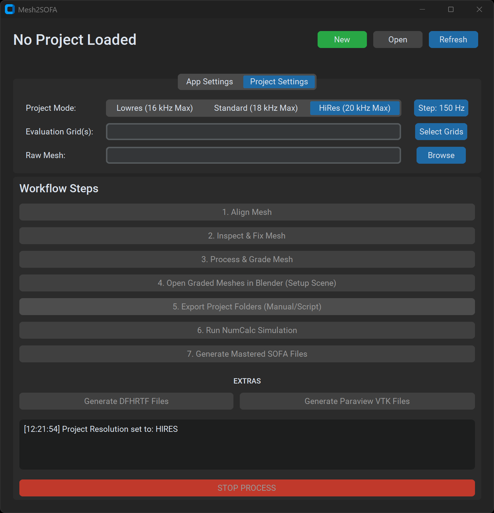
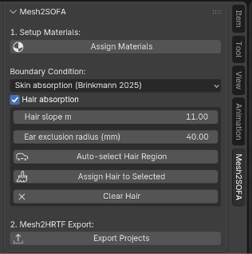

# Mesh2SOFA Orchestrator

An unofficial Python-based GUI orchestrator for [Mesh2HRTF](https://github.com/Mesh2HRTF/Mesh2HRTF) that streamlines the end-to-end workflow of generating personalized HRTFs. This tool automates the process from 3D mesh alignment to numerical simulation and final SOFA file export. It requires a 3D mesh of a head to start.

> **Note:** This is an unofficial orchestrator and is not directly affiliated with the Mesh2HRTF project.



## Features

* **Workflow Management:** Guided 7-step process from raw mesh to final SOFA.
* **Visual Interface:** User-friendly GUI built with CustomTkinter.
* **Formal Mesh Import:** Browsing for a raw mesh automatically runs a cleaning pipeline — sliver removal via Blender, structural repair via pymeshfix — before the mesh enters the project.
* **Mesh Inspection & Repair:** Dedicated step to detect and fix mesh problems (holes, non-manifold edges, self-intersections, topological tunnels). Includes an interactive 3D fixer for see-through holes ("tunnels"): it zooms to each defect, you choose **Fill the hole** or **Remove the bridge** with two clickable options (or Space / Tab), see a preview of each option, apply the fix, look at the result and press **Keep & Close** (or **Undo**) — nothing is saved until you keep it, then the window closes and re-validates the mesh, and a backup of the mesh from before the fix is kept.
* **Mesh Alignment:** Interactive 3D viewer for aligning the mesh to the Frankfurt plane with point picking and pitch fine-tuning.
* **Blender Automation:** Automatically sets up scenes for mesh grading and export.
* **Simulation Control:** Launches NumCalc simulations including "Test Mode" to process only the highest frequencies prior to full simulation.
* **SOFA Mastering:** Generates both raw and diffuse-field equalized SOFA files at 44.1 kHz and 48 kHz.
* **DFHRTF:** Compute and export DFHRTF responses with optional tilt.
* **VTK Viewer:** Export and view VTK files to observe sound pressure for each simulated frequency.
* **Cross-Platform:** Designed to run on Windows, Mac, and Linux.

## Prerequisites

To use this orchestrator, you must have the following installed:

1.  **Python 3.10+** including required packages (outlined below and in requirements.txt)
2.  **[Mesh2HRTF](https://sourceforge.net/projects/mesh2hrtf/)** including compiled NumCalc and Mesh Grading Tool executables.
    - NOTE: Make sure to compile NumCalc from source - the Windows binaries on mesh2HRTF-tools for Windows are outdated.
    - NumCalc binaries should be in the `Mesh2HRTF/NumCalc/bin` folder
3.  **[Blender](https://www.blender.org/)** (5.1 recommended; 4.0 or later) — required for the mesh import step and for Steps 4–5. Mesh2HRTF's own Blender add-on must be installed in it (see Installation step 4).
4.  **Additional Python Libraries** outlined below.

## Installation

1.  Clone the Mesh2SOFA repository:
    ```bash
    git clone https://github.com/variancelog/Mesh2SOFA.git
    ```

2.  Install required Python packages:
    ```bash
    pip install -r requirements.txt
    ```
    > **Note:** `mesh2hrtf` (from your Mesh2HRTF installation) and Blender's `bpy` are additional dependencies not installed via pip — see Prerequisites above.

3.  **Install/compile the mesh grading tool:**
    * **Windows:** You can install the compiled binaries from [mesh2hrtf-tools](https://sourceforge.net/p/mesh2hrtf-tools/code/ci/master/tree/hrtf_mesh_grading_WindowsExe/).
    * **Mac/Linux:** You must compile the tool from the source code included in your Mesh2HRTF installation.
        * Navigate to: `path/to/Mesh2HRTF/mesh2hrtf/Mesh2Input/Meshes/GradingDistanceBased`
        * Build the project using CMake (referenced by the `CMakeLists.txt` in that folder).

4. **Install the Blender Add-ons (Initial Setup only):**
    * Open Blender.
    * Go to **Edit > Preferences > Add-ons**.
    * Click **Install From Disk...** from the mini drop-down menu, select `mesh2hrtf/Mesh2Input/mesh2input.py` from your Mesh2HRTF folder and enable it. This is Mesh2HRTF's own add-on; the Mesh2SOFA export needs it.
    * Click **Install From Disk...** again and select `blender_scripts/mesh2SOFA_blender_addon.py` from this repository.
    * Search for "Mesh2SOFA Automation" in the list and enable it by checking the box (it should be checked by default).
    * The **Mesh2SOFA** panel will now always be available in the 3D Viewport sidebar (press 'N' to open the sidebar, or enable it from the "View" menu).
    * Blender keeps its own copy of the add-on: re-install it after a Mesh2SOFA update that changes the add-on version (currently v1.3.0). See [readme_blender-addon.md](readme_blender-addon.md).

### Where settings are stored

**Settings moved out of the repo.** Your Mesh2HRTF / Blender / grading-tool paths now live in a per-user file
(`app_settings.json` in `%LOCALAPPDATA%\Mesh2SOFA\` on Windows, `~/Library/Application Support/Mesh2SOFA/` on macOS,
`~/.config/Mesh2SOFA/` on Linux) instead of the repo's `app_settings.json`, which is no longer tracked. The repo
ships `app_settings.template.json` as a key reference. The first run imports any values from an old repo-root
`app_settings.json`.

*Upgrading from GitHub:* if you edited `app_settings.json`, `git pull` will refuse ("local changes would be
overwritten"). Move `app_settings.json` out of the repo folder, pull, then put it back; the first run imports it.
If you never edited it, nothing is lost. The Blender add-on is now v1.3.0 (it reads the per-user file): re-install it
in Blender.

## Usage

1.  Run the main application:
    ```bash
    python _project_manager_gui.py
    ```

2.  **Configuration:**
    * Create a New Project or Open an existing Project.
    * If your computer has limited RAM (e.g. 8-16GB), select the "Lowres" option from the Project Settings. This will use a slightly lower resolution graded mesh and calculate the HRTF only up to 16 kHz to save on RAM, but will still produce 44.1 kHz and 48 kHz SOFA files through upsampling.
      * NOTE: Limited RAM users are encouraged to use a shoulderless/torsoless mesh to greatly reduce RAM usage during simulation.
    * Select "HiRes" to calculate up to 20 kHz (19.95 kHz at the default 150 Hz step). It uses the same graded mesh as Standard, so accuracy in the 18–20 kHz band is **experimental**. Expect higher peak RAM at the top frequencies.
    * The **Step** button (Project Settings, default 150 Hz) sets the frequency step for the simulation. 150 Hz is sufficient for DFHRTF; 100 Hz gives a finer grid and 512-sample SOFA files, but simulates 1.5× more frequencies (about 1.5× NumCalc time). Changing the step after exporting from Blender needs a fresh export (see below). Projects saved before this setting existed open at 150 Hz.
    * Changing the mode after exporting from Blender needs a fresh export: delete `Exports/Left_Project` and `Exports/Right_Project` first (Mesh2HRTF will not overwrite an existing export), then export again. Before NumCalc runs, the GUI checks both exports against the project mode and step and warns on a mismatch. The step setting needs Mesh2SOFA add-on v1.3.0 or later — if the warning persists after re-exporting, reinstall the add-on in Blender.
    * Under **App Settings**, configure your Mesh2HRTF root folder, **Blender executable** path (required — used both for mesh import and Step 4), and the **Mesh Grading Tool** binary.
    * Under **Project Settings**, select your **Evaluation Grid(s)** and resolution mode. The list shows the grids in your Mesh2HRTF folder (`Mesh2Input/EvaluationGrids/Data`). Extra grids ship in `evaluation_grids/`; copy a grid folder there to use it (see [README_evaluation_grids.md](evaluation_grids/README_evaluation_grids.md)).

3.  **Workflow:**

    * **Browse for Raw Mesh** is the entry point for your 3D head scan (`.obj`, `.ply` or `.stl`). Clicking Browse prompts you to Move or Copy the file into the project, then automatically runs a full cleaning pipeline: it inspects for defects, removes tiny sliver triangles via Blender, and repairs structural issues with pymeshfix. A popup summarises the result. If a see-through hole (a topological tunnel) is detected, you will see a warning — it can only be fixed after alignment in Step 2. The Raw Mesh field is read-only; Browse is the only way to set it.

    * **1. Align Mesh** stays greyed out until a raw mesh has been imported and its cleaning pipeline has finished. It opens an interactive 3D viewer. In Phase 1, pick three landmarks: Left Ear, Right Ear, and Nose Tip. In Phase 2, use a slider to fine-tune the pitch (tilt) of the head to ensure it is level.

    * **2. Inspect & Fix Mesh** is one click: it checks the aligned mesh, repairs holes, non-manifold edges and self-intersections automatically with pymeshfix (a one-time backup of the mesh is kept first), and, if only topological tunnels (genus > 0 "pierced-ear" artifacts that break BEM simulation) remain, opens the see-through-hole fixer straight away. If the automatic repair cannot fix the mesh, one dialog explains the problem in plain words and offers **Try repair again** or **Close** (the hole fixer is not offered on a mesh that is not watertight; the Blender route below still works). The **Restore mesh from before Step 2 fixes** button (header of the Workflow Steps box, shown only while an unused backup exists) puts the original aligned mesh back and then disappears until the next fix creates a new backup. In the hole fixer, for each defect it asks which is the scanning mistake — the see-through hole or the thin strand of material next to it — and offers two options: **Fill the hole** (plugs the channel flush; pre-selected, usually right) and **Remove the bridge** (cuts the strand away). Click an option card (or press **Space**), use **Prev / Next** (or **Tab** / **Shift+Tab**) to move between defects, and press **Confirm this fix** (or **F**) once you are happy with the choice for that defect (a progress row shows how many are confirmed; you can also click a defect's number to jump to it). **Apply all selected fixes** (or **C**) unlocks only when every defect is confirmed. Each option card shows whether its preview is ready, and **P** (or the *Show: Before / After* button) switches the 3D view between the mesh as it is and what the selected option would produce; an option whose safety checks fail is greyed out. Apply then shows the real result with a banner such as *Fixed — 0 defects left* and two buttons: **Keep & Close** (replaces `aligned_head.ply`, keeps a backup, re-validates the mesh; if more holes remain the app offers **Fix the next defect**) and **Undo** (**Esc**; nothing was written). Closing the window with an unkept fix asks whether to discard it. **Z** zooms to the defect (from the direction where it is least hidden by the ear; if it is still mostly hidden, see-through is switched on for you), **H** shows the whole head and **X** makes the head see-through. In the After view the surface the fix added is coloured soft green. The selected ring is drawn red and the other blue. If the fix cannot be applied safely, nothing is changed. This step is required unless the import was already clean: **3. Process & Grade** stays greyed out until Step 2 is done. If the import report shows a clean mesh (no problems, no see-through holes), Step 2 shows as done (blue) straight after alignment and grading is available; otherwise Step 2 is green and grading unlocks once the check passes. You can still click Step 2 again to re-check.

    * **3. Process & Grade Mesh** is locked (greyed out) until Step 2 is done; it then uses PyMeshLab to optimize the mesh for your selected resolution (Lowres, or Standard — also used by HiRes), then runs the mesh grading tool to produce optimized left and right meshes for NumCalc.

    * **4. Open Graded Meshes in Blender** opens a reference Blender scene containing the graded meshes and materials. If a `.blend` already exists, you can choose to open it as-is or overwrite it with a fresh import.

    * **5. Export Project Folders** is done inside Blender using the Mesh2SOFA panel (details below). This generates the `Left_Project` and `Right_Project` folders used by NumCalc.

    * **6. Run NumCalc Simulation** runs multiple NumCalc instances against your project folders. This step is very compute- and memory-intensive and can take 8–24 hours on a typical home computer. Use "Test Mode" to run a stability check on the highest frequencies before committing to a full simulation. Test Mode runs both ears at the same time and prints live progress to the log (current phase, elapsed time, NumCalc memory use and free RAM); if free RAM drops below 4 GB it automatically falls back to running the ears one after the other. You can stop the simulation at any time with the **STOP PROCESS** button — simulation output is preserved so you can resume later.

    * **7. Generate Mastered SOFA Files** produces four SOFA file variants: diffuse-field equalized and non-equalized, at both 44.1 kHz and 48 kHz. Either variant can be used with SPARTA Binauraliser (which has a built-in optional "Apply Diffuse-Field EQ" setting), while renderers such as APL Virtuoso expect pre-equalized files.

    * **EXTRAS:**
      * **Generate DFHRTF Files** generates tilted diffuse-field responses as CSV files for left, right, and average channels, plus frequency response plots. You can specify a tilt value (e.g. -1.0 dB/octave) and run it multiple times to test different outputs. It also writes a convolution-ready stereo minimum-phase impulse of the same curve (`... MinPhase.wav`, 2 ch, 4096 samples, 32-bit float).
      * **Generate Paraview VTK Files** exports pressure data from your simulation into VTK format for a specified frequency range. Use the included `_vtk_viewer.py` tool (or ParaView) to interactively visualize the acoustic pressure fields around the head model (see [readme_vtk_export.md](readme_vtk_export.md)).

## Blender Steps



Once the Blender Add-on is installed (see Installation step 4), use the **Mesh2SOFA** panel in the 3D Viewport sidebar to complete Step 5:

1. Press **'N'** in the 3D Viewport to open the sidebar if it's not already visible.
2. Click the **Mesh2SOFA** tab.
3. **Step 1: Assign Materials.** Click `Assign Materials`. This will:
   - Create the necessary `Skin`, `Left Ear`, and `Right Ear` materials.
   - Assign `Skin` to the `Left_Graded` and `Right_Graded` meshes.
   - Automatically find the ear openings and assign the correct ear material to the closest face on each side.
   - Create an (initially unused) `Hair` material slot.
   - NOTE: double-check that the left and right ear materials are applied to the correct locations (success depends on the position of the ear canal entrance relative to the tragus shape/size). Re-running Assign Materials resets all faces, including any painted hair, to `Skin`.
4. **Boundary Condition.** Choose how the head surface is simulated:
   - **Skin absorption (Brinkmann 2025)** (default): the `Skin` material gets the skin admittance recommended by Brinkmann et al. (2025). The material file is written to `Exports/Materials/Skin.csv`.
   - **Rigid (legacy)**: a fully rigid surface, as in earlier Mesh2SOFA versions.
   - **Hair absorption** (optional, Skin mode only): tick the checkbox, then click `Auto-select Hair Region` to mark the hair region on both meshes with the `Hair` material (faces near the ears are kept as skin; adjust with *Ear exclusion radius*). Refine it with `Assign Hair to Selected` (select faces in Edit Mode on the active mesh) or start over with `Clear Hair`. *Hair slope m* controls how quickly hair absorption rises with frequency: about 4.5 for thin/short hair, 11 for medium, 18 for thick hair.
   - These settings are saved in the `.blend` file. If hair is off, any painted hair region is exported as skin (the painting itself is kept).
5. **Step 2: Export Projects.** Click `Export Projects`. This generates the two project folders needed by NumCalc in your project's `Exports` folder. The add-on then checks the generated `NC.inp` files to confirm the selected boundary condition was actually written, and the success message names it (e.g. "Boundary: skin absorption + hair (m=11)"). The main GUI also logs the boundary condition when you start the NumCalc test or full simulation.

If there are errors or missing output in the `Exports` folder, check the Blender system console for details. Common issues include `Left_Graded` or `Right_Graded` meshes missing from the scene. [readme_blender-addon.md](readme_blender-addon.md) has the full add-on guide, including where it reads its settings and a troubleshooting table.

## More Documentation

* [readme_blender-addon.md](readme_blender-addon.md) — the Blender add-on in detail.
* [evaluation_grids/README_evaluation_grids.md](evaluation_grids/README_evaluation_grids.md) — the extra evaluation grids and how to install them.
* [core/readme_dfhrtf_calculation.md](core/readme_dfhrtf_calculation.md) — how the diffuse-field HRTF is calculated.
* [readme_vtk_export.md](readme_vtk_export.md) — how the VTK export works.
* [CHANGELOG.md](CHANGELOG.md) — version history.

## Related Tools

* **[SOFA Buddy](https://github.com/variancelog/SOFABuddy)** — standalone tool for working with existing SOFA files (mastering, DFHRTF and more). It replaces the SOFA Mastering Tool that used to ship with Mesh2SOFA ([note](readme_sofa_mastering_tool.md)).

## License

This project is licensed under the MIT License - see [LICENSE.md](LICENSE.md) for details.

**Note:** This is an unofficial orchestrator and is not directly affiliated with the Mesh2HRTF project.
