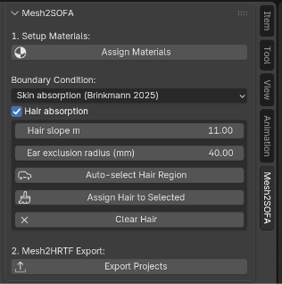

# Mesh2SOFA Blender Add-on

`blender_scripts/mesh2SOFA_blender_addon.py` (current version: **v1.3.0**) adds a **Mesh2SOFA** panel to Blender's 3D Viewport sidebar. It covers the Blender part of the Mesh2SOFA workflow (Step 5): it assigns the materials NumCalc needs, sets the skin / hair boundary condition, and exports the `Left_Project` and `Right_Project` folders with Mesh2HRTF.

## Requirements

* **Blender 4.0 or later** (5.1 recommended).
* **Mesh2HRTF's own Blender add-on** (`mesh2hrtf/Mesh2Input/mesh2input.py` in your Mesh2HRTF folder) installed and enabled. The Mesh2SOFA add-on calls it to write the project folders; without it, Export Projects stops with "Mesh2HRTF Addon not installed!".
* A Mesh2SOFA project opened through **4. Open Graded Meshes in Blender** in the main GUI. That step creates the `.blend` in the project folder and imports `Left_Graded` and `Right_Graded`. The add-on finds the project from the location of the saved `.blend`, so the file must stay in the project folder next to `project.json`.

## Installing and updating

1. In Blender, open **Edit > Preferences > Add-ons**.
2. Choose **Install From Disk...** from the drop-down menu and select `blender_scripts/mesh2SOFA_blender_addon.py`.
3. Enable **Mesh2SOFA Automation** if it is not already ticked.
4. Press **N** in the 3D Viewport and open the **Mesh2SOFA** tab.

Blender keeps its own copy of the file, so **updating Mesh2SOFA does not update the installed add-on**. Re-install it (same steps) whenever the add-on version changes. The installed version is shown next to the add-on's name in Blender's Add-ons list.

| Feature | Needs add-on |
|---|---|
| Skin / hair boundary conditions | v1.2.0 |
| Reads the per-user `app_settings.json` (Mesh2HRTF path) | v1.2.1 |
| Frequency step setting (150 / 100 Hz) | v1.3.0 |

## Where the add-on gets its settings

The panel only holds the boundary-condition settings. Everything else comes from the main GUI:

| Setting | Source | Fallback |
|---|---|---|
| Mesh2HRTF path | `mesh2hrtf_path` in the per-user `app_settings.json` (see the main README), then a legacy `app_settings.json` next to the add-on file | `C:\Mesh2HRTF\mesh2hrtf` |
| Evaluation grid(s) | `eval_grid` in `project.json` | `Default` |
| Resolution mode | `project_resolution` in `project.json` | Standard |
| Frequency step | `step_size` in `project.json` | 150 Hz |
| Boundary condition, hair settings | The panel (saved in the `.blend`) | Skin absorption, hair off |

Change the grid, mode or step in the main GUI, not in Blender.

### Exported frequencies

The export runs in equal steps (first frequency = one step) up to the mode's maximum, rounded down onto the step grid:

| Mode | 150 Hz step | 100 Hz step |
|---|---|---|
| Lowres | 16050 Hz (107 frequencies) | 16000 Hz (160) |
| Standard | 18000 Hz (120) | 18000 Hz (180) |
| HiRes | 19950 Hz (133) | 20000 Hz (200) |

Other export settings are fixed: ML-FMM BEM, mesh unit mm, speed of sound 343.18 m/s, air density 1.1839 kg/m³.

## Using the panel

### 1. Assign Materials

Click **Assign Materials**. For `Left_Graded` and `Right_Graded` it:

* creates the `Skin`, `Left ear`, `Right ear` and `Hair` materials (`Hair` starts unused),
* sets every face to `Skin`,
* finds the ear opening on each mesh and gives the closest face the matching ear material.

**Check the result**: the blue (left) and red (right) ear faces must sit at the ear canal entrances. Success depends on where the canal entrance lies relative to the tragus. Running Assign Materials again resets every face, including a painted hair region, to `Skin`.

### Boundary Condition

* **Skin absorption (Brinkmann 2025)** — default and recommended. The `Skin` material gets the skin admittance from Brinkmann et al. (2025). The table is written to `Exports/Materials/Skin.csv`.
* **Rigid (legacy)** — a fully rigid surface, as in early Mesh2SOFA versions.

**Hair absorption** (optional, Skin mode only). Tick the checkbox to show the hair controls:

* **Hair slope m** — how quickly hair absorption rises with frequency: about 4.5 for thin or short hair, 11 for medium (default), 18 for thick hair.
* **Ear exclusion radius (mm)** — the region around the ears that Auto-select keeps as skin, measured from the ear-to-ear axis (default 40 mm).
* **Auto-select Hair Region** — marks the top and back of the head on both meshes as `Hair`, using rules adapted from the paper.
* **Assign Hair to Selected** — sets the faces selected in Edit Mode on the active mesh to `Hair`. Use it to refine the region.
* **Clear Hair** — sets all hair faces on both meshes back to `Skin`.

The ear faces are never changed by the hair tools. The hair region is simply the set of faces that use the `Hair` material, so you can also inspect it in Blender's material view. If hair absorption is switched off, a painted hair region is exported as skin, and the painting itself is kept.

These settings are saved in the `.blend` file, per project.

### 2. Export Projects

Click **Export Projects**. The add-on writes `Exports/Left_Project` and `Exports/Right_Project`, then reads each generated `NC.inp` to confirm that the selected boundary condition was really written. The success message names it, for example "Boundary: skin absorption + hair (m=11)". Then return to the main GUI for Step 6.

Mesh2HRTF does not overwrite an existing export. To export again (new mode, step, grid or boundary condition), delete `Exports/Left_Project` and `Exports/Right_Project` first.

## Troubleshooting

Details of every error are printed to Blender's system console (**Window > Toggle System Console** on Windows).

| Message | Cause and fix |
|---|---|
| Mesh2HRTF Addon not installed! | Install and enable Mesh2HRTF's `mesh2input.py` add-on in Blender. |
| Save .blend file first! | The scene is not saved. Open the project through Step 4 of the main GUI. |
| Missing Object: Left_Graded / Right_Graded | The graded meshes are not in the scene, or were renamed. Re-run Step 4 with a fresh import. |
| No materials assigned! / Missing materials: ... | Run **Assign Materials** first. |
| hair absorption is on but no faces use the Hair material | Run **Auto-select Hair Region**, or untick Hair absorption. |
| RIGID export aborted: Skin.csv / Hair.csv found in Mesh2HRTF's material folder | A material file in Mesh2HRTF's `Mesh2Input/Materials/Data` would make the export non-rigid. Remove or rename it, or choose Skin absorption. |
| boundary check FAILED | The written `NC.inp` does not match the selected boundary condition. Delete the export folders and export again; if it persists, check the console output. |
| The main GUI warns that the export does not match the project | Usually an old installed add-on or a stale export. Re-install the add-on, delete the export folders and export again. |

## Reference

Brinkmann et al. (2025) ([https://doi.org/10.61782/fa.2025.0499](https://doi.org/10.61782/fa.2025.0499)), skin and hair absorption for HRTF simulation. The add-on's material assignment is adapted from `AssignMaterial.py` by Robert Pelzer and Fabian Brinkmann (Audio Communication Group, TU Berlin).
